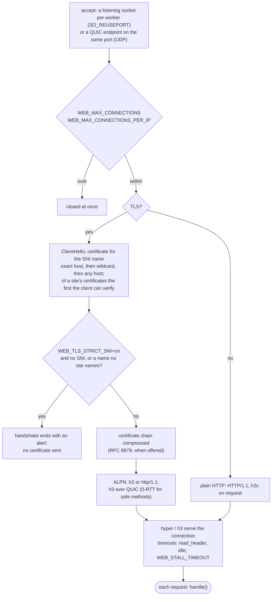
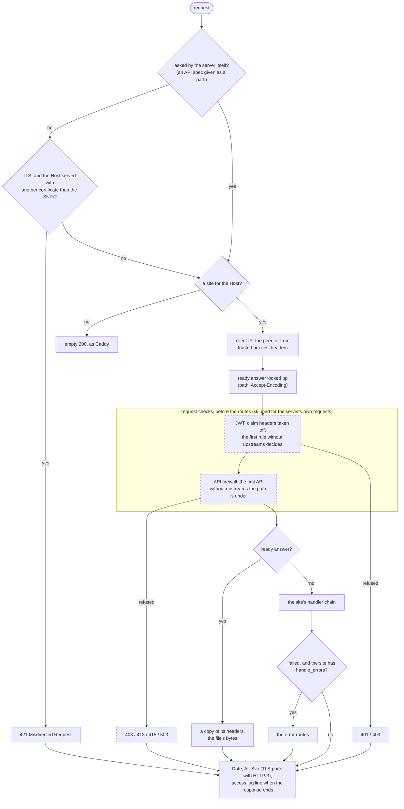
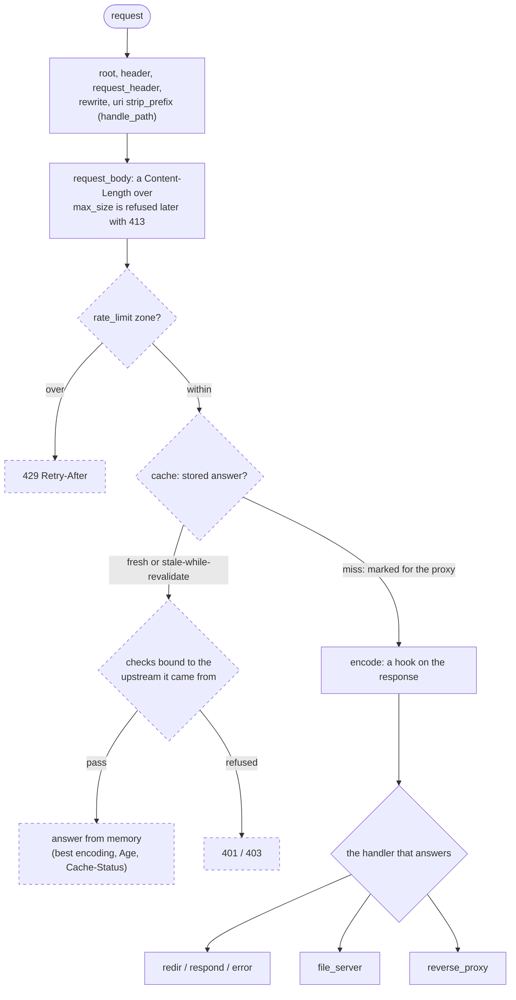
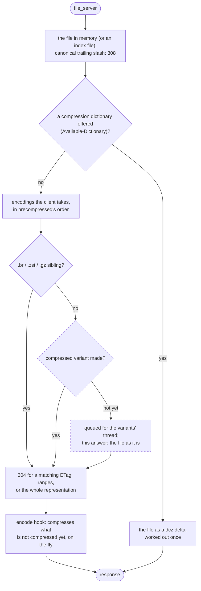
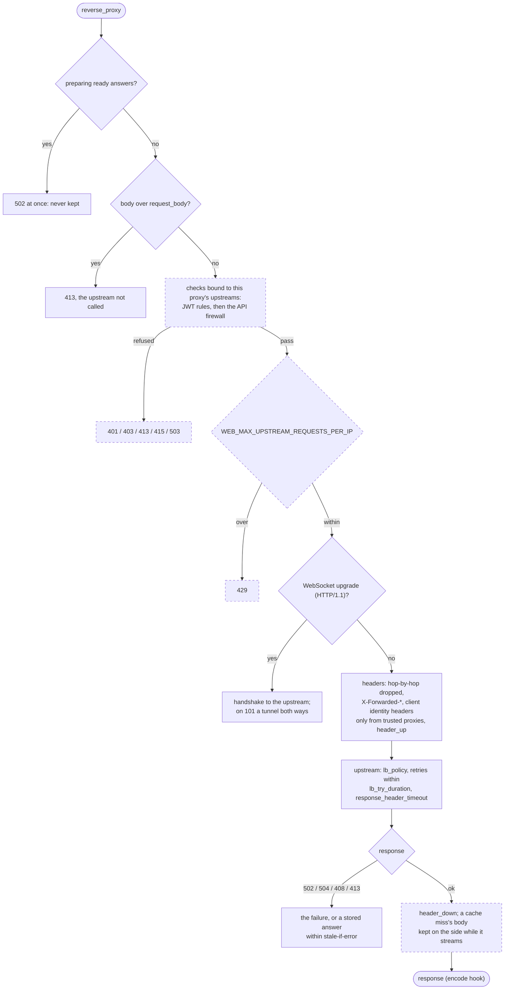
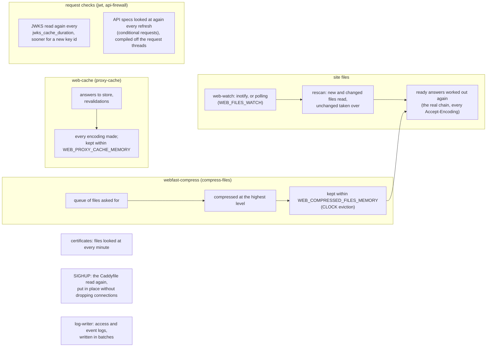

# Overview

How webfast answers a request: what a connection goes through, what a request goes through, the
handler chain a site's routes make, and the work done in the background. Steps drawn dashed belong
to a cargo feature (all on in the default build); without it they are not built, and the request
goes on as if the step were not there. The table at the end lists where each feature takes part.

## A connection

The connection keeps the SNI name its handshake asked for, for the Host check of each request.
With `WEB_RELOAD=lazy` or `drain` it also keeps the routing it was accepted with.

## A request

A refusal replaces the answer: it is logged in the site's access log like any other response, and
the check's event log says why (docs/configuration.md, Request checks).

## The handler chain

Outside `route` blocks the directives are sorted as Caddy sorts them; inside, they run in the
order written. Each step either changes the request and goes on, or answers; the diagram shows
the usual order of the steps a site has.

### file_server

A file larger than `WEB_MAX_FILE_IN_MEMORY` is streamed from disk instead, with one range at
most.

### reverse_proxy

## In the background

## Where the features take part

| Feature          | Where                                                                         | What it adds                                                                                               |
| ---------------- | ----------------------------------------------------------------------------- | ---------------------------------------------------------------------------------------------------------- |
| `jwt`            | `handle()` before the routes; `reverse_proxy` and `cache` hits for `upstreams` | JWT validation (`WEB_JWT_CONFIG`); claim headers set, the token taken off; `Credentialed` for the cache     |
| `api-firewall`   | `handle()` before the routes; `reverse_proxy` and `cache` hits for `upstreams` | OpenAPI request validation (`WEB_API_FIREWALL_CONFIG`); the body read once and passed on                   |
| `rate-limit`     | the `rate_limit` directive; `reverse_proxy` before the upstream               | requests per key and window; a client's requests at the upstreams at once                                  |
| `proxy-cache`    | the `cache` directive; `reverse_proxy` on a miss                              | proxied answers kept in memory, in every encoding, stale answers while revalidating or when the upstream fails |
| `compress-files` | `file_server` when a file has no precompressed sibling                        | compressed variants made in the background, served like siblings                                           |
| `mimalloc`       | the allocator                                                                 | mimalloc instead of the system's                                                                           |

The request checks are configured outside the Caddyfile, so an edit there cannot switch them off;
a check bound to an upstream that no `reverse_proxy` sends to stops the startup and a reload.
